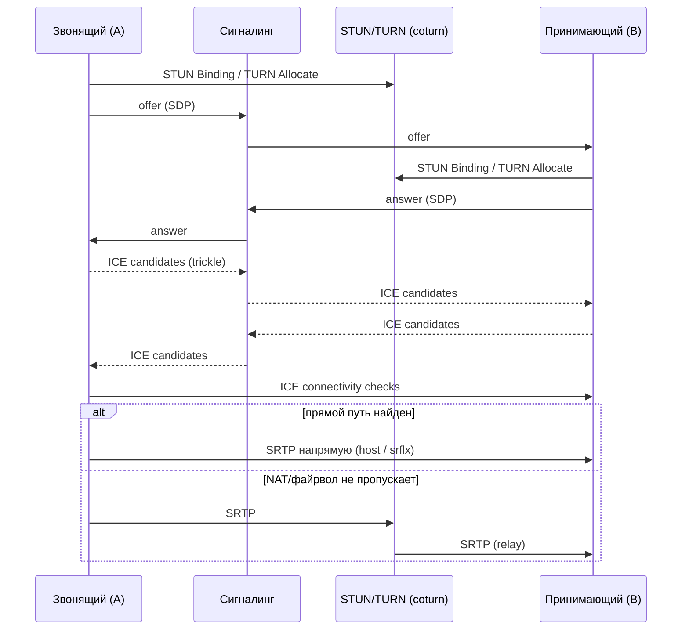

# Звонки 1-1 на flutter_webrtc: план прототипа

2026-11-05

**Рекомендация:** взять готовый WebSocket-сигналинг [flutter-webrtc-server](https://github.com/flutter-webrtc/flutter-webrtc-server) и поднять рядом в Docker свой coturn, он будет и STUN, и TURN-fallback. Сигналинг через Nostr оставить на второй этап, спрятав оба варианта за общим интерфейсом.

> Ссылки и детали собраны по памяти, без проверки по источникам. Перед стартом сверьте актуальность репозиториев и бесплатных лимитов.

## Цель и объём

Прототип: два Flutter-клиента (iOS и Android) звонят друг другу 1-1 с видео и звуком через собственный backend. Он должен ответить на два вопроса.

- **Подводные камни:** NAT и мобильные сети, разрешения, аудио-маршруты, работа в фоне, смена сети во время звонка.
- **Демо для Upwork:** звонок между телефонами в разных сетях (Wi-Fi и LTE). На экране оверлей с типом соединения (P2P или relay), RTT и битрейтом. Показать переключение сети без обрыва и принудительный relay.

В объём не входят: групповые звонки, push о входящем звонке при закрытом приложении (PushKit/FCM), запись звонков, E2EE поверх SRTP.

## Как устроен звонок

Есть три независимых канала, и ломаются они по-разному:

1. **Сигналинг** (WebSocket или Nostr) передаёт SDP offer/answer, ICE-кандидаты и hangup. Медиа через него не идёт.
2. **ICE** (STUN/TURN) находит путь между устройствами. STUN сообщает устройству его внешний IP:порт (кандидат `srflx`). TURN ретранслирует трафик, когда прямой путь не находится (кандидат `relay`).
3. **Медиа** (SRTP по UDP, реже по TCP/TLS) идёт напрямую P2P или через TURN.

Минимальный набор на клиенте: `RTCPeerConnection` с `iceServers`, `getUserMedia`, `RTCVideoRenderer`, обработка `onIceCandidate`, `onTrack`, `onConnectionState`, а также очередь кандидатов, пришедших раньше `setRemoteDescription`.

## Сигналинг: Nostr или готовый сервер

Для прототипа и демо лучше готовый WebSocket-сервер. Клиенты на Upwork почти всегда ждут именно такую схему, а готовый клиент-пример экономит несколько дней. Nostr интересен как вторая реализация для `packages/chat`.

| Вариант | Что это | Плюсы | Минусы |
| --- | --- | --- | --- |
| [flutter-webrtc-server](https://github.com/flutter-webrtc/flutter-webrtc-server) (рекомендуется) | Сервер на Go от авторов flutter_webrtc: WebSocket-сигналинг и встроенный TURN | Совместим с [flutter-webrtc-demo](https://github.com/flutter-webrtc/flutter-webrtc-demo), где уже готов клиент с offer/answer, bye и списком пиров | Нет авторизации и офлайн-доставки; встроенный TURN лучше заменить на coturn |
| Свой мини-сервер (Node `ws`, около 100 строк) | Комнаты и ретрансляция JSON | Полный контроль протокола | Это уже не «готовое с GitHub» |
| [LiveKit](https://github.com/livekit/livekit) | SFU-сервер со своим сигналингом и TURN | Продакшн-уровень, есть Flutter SDK `livekit_client` | Это уже не чистый flutter_webrtc и не P2P, подводные камни скрыты |
| Nostr | offer/answer/candidates как эфемерные события (kind 20000–29999), зашифрованные NIP-44 | Своего сервера нет, адресация по pubkey, клиент и NIP-44 уже есть в `packages/nostr` | Нет принятого NIP; задержка релея; не все релеи ретранслируют эфемерные события; метаданные звонка (кто кому звонит) видны релею |

Как сделать, чтобы потом не переписывать:

- На клиенте один интерфейс `SignalingChannel`: отправка offer, answer, candidate и hangup плюс поток входящих сообщений. Первая реализация на WebSocket, вторая на Nostr.
- Для Nostr: один эфемерный kind, содержимое зашифровано NIP-44, тег `p` собеседника, `call-id` в содержимом. ICE-кандидаты собирать пачками по 200–300 мс, иначе на один звонок уходят десятки событий.
- Пример звонков поверх Nostr на Flutter — [0xchat](https://github.com/0xchat-app). Их протокол стоит посмотреть до выбора kind.

## STUN: где взять и как проверить

**Публичные STUN** (бесплатно, без регистрации), годятся для первых тестов:

- `stun:stun.l.google.com:19302` (а также `stun1`…`stun4`);
- `stun:stun.cloudflare.com:3478`.

**Свой STUN+TURN:** [coturn](https://github.com/coturn/coturn), официальный Docker-образ `coturn/coturn`. Один процесс закрывает и STUN, и TURN. Ключевые настройки:

- `listening-port=3478` (UDP+TCP), `tls-listening-port=5349` или 443 для TLS;
- `external-ip=<публичный IP>` — обязательно, если coturn стоит за NAT или в Docker bridge;
- `min-port` / `max-port` — диапазон relay-портов, например 49160–49200 для прототипа. Его нужно открыть в файрволе. В Docker проще `network_mode: host`, чем пробрасывать сотни портов;
- `use-auth-secret` + `static-auth-secret` — временные логин и пароль (TURN REST API): клиент получает их у backend, а не хранит в приложении;
- `realm`, `fingerprint`, `lt-cred-mech`.

Сервер нужен с публичным IP (VPS). TURN на ноутбуке за домашним NAT для демо не подходит.

**Как протестировать:**

1. [Trickle ICE](https://webrtc.github.io/samples/src/content/peerconnection/trickle-ice/) (в браузере): добавить `stun:`/`turn:` URL с логином и паролем и нажать «Gather candidates». Тип `srflx` означает, что STUN работает, тип `relay` — что TURN работает. Отсутствие `relay` обычно значит неверные креды, закрытые порты или неверный `external-ip`.
2. Утилиты из пакета coturn: `turnutils_stunclient <host>` проверяет STUN; `turnutils_uclient -u user -w pass <host>` делает allocation и гоняет трафик через TURN.
3. В самом приложении: `pc.getStats()` и пара кандидатов в состоянии `succeeded` (`candidateType` local/remote). Это же выводится в оверлей для демо.
4. Принудительно включить `iceTransportPolicy: 'relay'` и проверить, что звонок идёт только через TURN.

## Fallback при неудаче P2P

Готовое решение есть, и оно стандартное: **TURN-relay**. ICE сам перебирает кандидаты (host, затем srflx, затем relay) и выбирает работающую пару. Если в `iceServers` прописан TURN, fallback происходит автоматически, отдельной логики писать не нужно.

Когда без relay не обойтись: симметричный NAT, CGNAT мобильных операторов, корпоративные сети с закрытым UDP. По разным оценкам, это 10–20 % звонков.

Чтобы fallback работал и в строгих сетях:

- TURN по UDP 3478, затем по TCP 3478, затем **TURN over TLS на 443** (`turns:host:443?transport=tcp`). Последний вариант проходит почти через любой файрвол;
- в `iceServers` указать все три URL;
- при смене сети (Wi-Fi → LTE) делать **ICE restart** (`restartIce()` или новый offer с `iceRestart: true`) по событию `disconnected`/`failed`.

Если свой TURN поднимать не хочется: [Open Relay](https://www.metered.ca/tools/openrelay/) от Metered, Cloudflare Realtime TURN, Twilio Network Traversal, Xirsys. У части из них есть бесплатный лимит; для демо этого хватит.

SFU вроде LiveKit, Janus или mediasoup — это не fallback для 1-1, а другая архитектура (медиа всегда через сервер). Его стоит упоминать клиенту как путь к групповым звонкам.

## Подводные камни flutter_webrtc

- **Порядок сигналинга:** кандидаты приходят до `setRemoteDescription`, их нужно ставить в очередь. Если оба звонят одновременно (glare), нужна схема «perfect negotiation» или правило, кто уступает.
- **Мобильные сети:** CGNAT на LTE почти всегда требует TURN. Тестировать только в одной Wi-Fi сети бессмысленно, там работает `host`-кандидат.
- **Docker и coturn:** без `external-ip` и открытого диапазона relay-портов TURN «работает» в Trickle ICE для STUN, но `relay`-кандидатов нет.
- **Разрешения:** камера и микрофон (`NSCameraUsageDescription`, `NSMicrophoneUsageDescription`; на Android `CAMERA`, `RECORD_AUDIO`, `MODIFY_AUDIO_SETTINGS`, `BLUETOOTH_CONNECT`).
- **Фон:** на iOS нужен `UIBackgroundModes: audio, voip`; видео в фоне останавливается. На Android 14+ нужен foreground service с типами `camera` и `microphone`.
- **Входящий звонок при закрытом приложении:** CallKit + PushKit на iOS, ConnectionService/FCM на Android (например, `flutter_callkit_incoming`). Это самая трудоёмкая часть продакшна; в прототипе её стоит только назвать.
- **Аудио:** динамик или разговорный динамик (`Helper.setSpeakerphoneOn`), Bluetooth-гарнитура, эхо при громкой связи.
- **Устройства:** в iOS-симуляторе нет камеры, тестировать на реальных телефонах. Кодеки: H.264 против VP8 и аппаратное кодирование на старых Android.
- **Креды TURN:** временные и истекают. Долгий звонок с ICE restart после истечения не переподключится.
- **Нагрузка:** relay-трафик идёт через ваш VPS, это примерно 1–2 Мбит/с на видеозвонок в каждую сторону.

## План прототипа и сценарий демо

1. Арендовать VPS с публичным IP и поднять в Docker coturn и flutter-webrtc-server.
2. Проверить coturn через Trickle ICE и `turnutils_uclient` (есть `srflx` и `relay`).
3. Взять клиент из flutter-webrtc-demo как основу, вынести сигналинг за `SignalingChannel`, прописать свои `iceServers`.
4. Добавить: очередь кандидатов, ICE restart при смене сети, переключатель «только relay», оверлей со `getStats` (тип кандидата, RTT, битрейт).
5. UI звонка: вызов, принять или отклонить, mute, камера вкл/выкл, переключение фронтальной и тыльной камеры, динамик, завершение.
6. Прогнать матрицу: Wi-Fi ↔ Wi-Fi, Wi-Fi ↔ LTE, LTE ↔ LTE, iOS ↔ Android; записать, где понадобился relay.
7. Опционально: вторая реализация `SignalingChannel` на Nostr (эфемерный kind + NIP-44).

**Сценарий видео (2–3 минуты):**

1. Два телефона рядом, один на LTE, другой на Wi-Fi; коротко показать архитектуру.
2. Звонок, принятие, видео в обе стороны; на оверлее P2P (`srflx`) и RTT.
3. Mute, переключение камеры, громкая связь.
4. Выключить Wi-Fi на одном телефоне: звонок восстанавливается через ICE restart.
5. Включить «только relay»: оверлей показывает `relay`, звонок продолжается.
6. Завершение; в конце перечислить, что ещё можно сделать: CallKit, push, групповые звонки на SFU.
